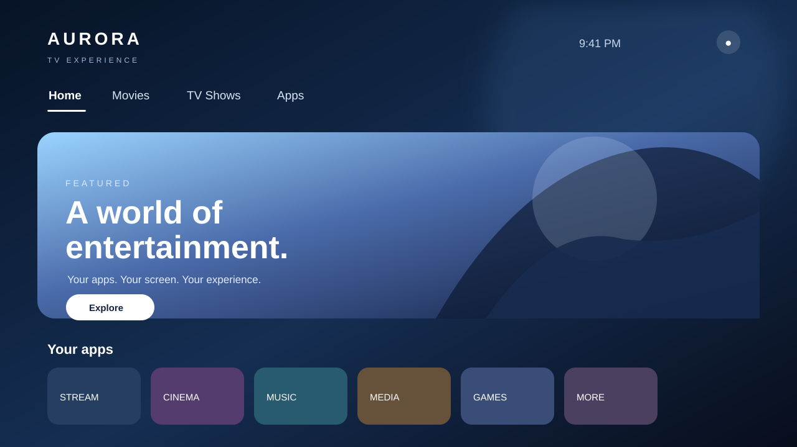

# AURORA TV

  

  <strong>A cinematic, remote-first home launcher for Android TV and Google TV.</strong> 
  A clean home for your installed apps, designed around the television screen and the D-pad.

  
  
  
  

## The experience

AURORA TV is an independent Android launcher project focused on a polished, cinematic television interface. It aims to make the TV home screen feel calm, visual and easy to navigate from the sofa.

### Home screen concept

### App library concept

### Control Center concept

> These images are design concepts for the intended experience, not screenshots captured from a running device. The current app implementation is earlier and more limited; see the status below.

## Implemented in the current baseline

- Native Android application registered as a HOME / LEANBACK launcher.
- Minimum SDK 21 (Android 5.0).
- Discovers installed Leanback and standard launchable applications.
- D-pad / keyboard focus navigation and OK/Enter app launching.
- Horizontal app row with focus feedback.
- App Library dialog.
- Refresh installed apps and open Android Settings.
- GitHub Actions debug build workflow; the latest build completed successfully and published the `aurora-tv-debug-apk` artifact.

## In development

- A more complete tvOS-inspired home layout and navigation.
- Search and a full multi-row application library.
- Persistent favourites, profiles and personalization.
- A functional launcher Control Center using supported Android settings intents.
- Idle screensaver, wallpaper options and polish.
- Device-by-device compatibility and accessibility testing.

## Build

Open the repository in Android Studio with JDK 17, sync Gradle, then run the `app` configuration or build the `:app:assembleDebug` task.

The GitHub Actions workflow builds a debug APK on pushes to `main`. Open the repository's **Actions → Android build → Artifacts** to retrieve the generated debug artifact.

## Compatibility

The project declares Android 5.0 (API 21) as its minimum. This is a build target, not a guarantee that every TV model supports every launcher feature. Default Home selection, app discovery and device settings vary by manufacturer and Android version; real-device testing is still required.

## Project principles

- Television-first layout and remote control navigation.
- Lightweight native Android implementation.
- Local-first operation; no account or cloud service is required by the current baseline.
- Installed applications keep their own names and icons.

## Disclaimer

AURORA TV is an independent community project and is not affiliated with, endorsed by, or sponsored by Apple. Any visual inspiration is limited to general interface principles; Apple branding and proprietary assets are not included.

## License

No open-source license has been added yet. All rights remain with the repository owner unless a license is added.
